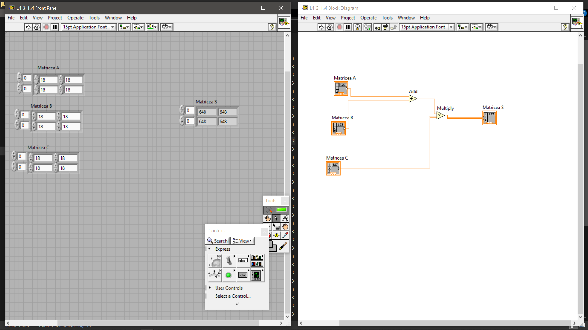
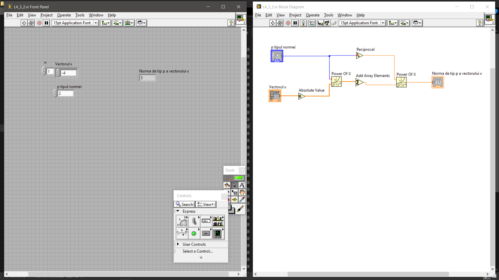
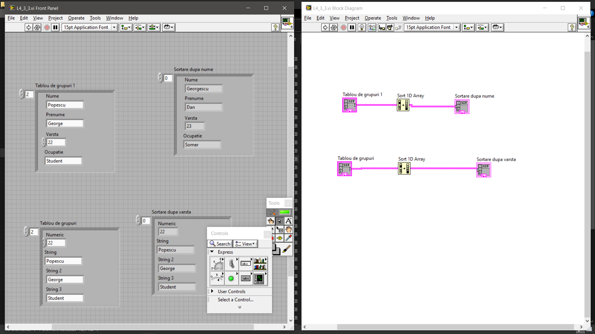
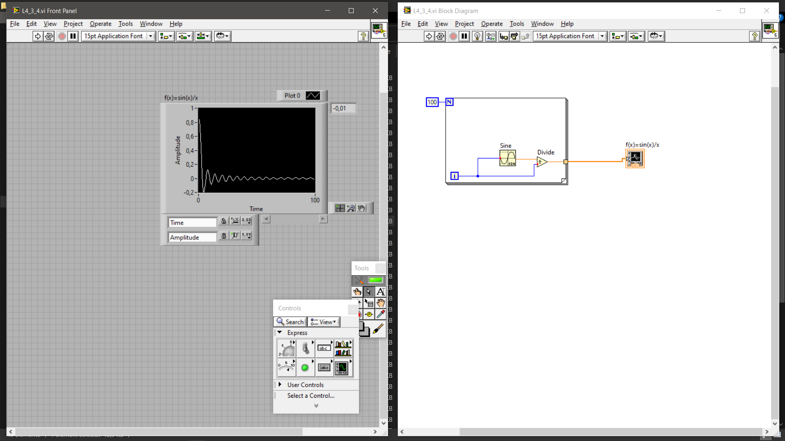
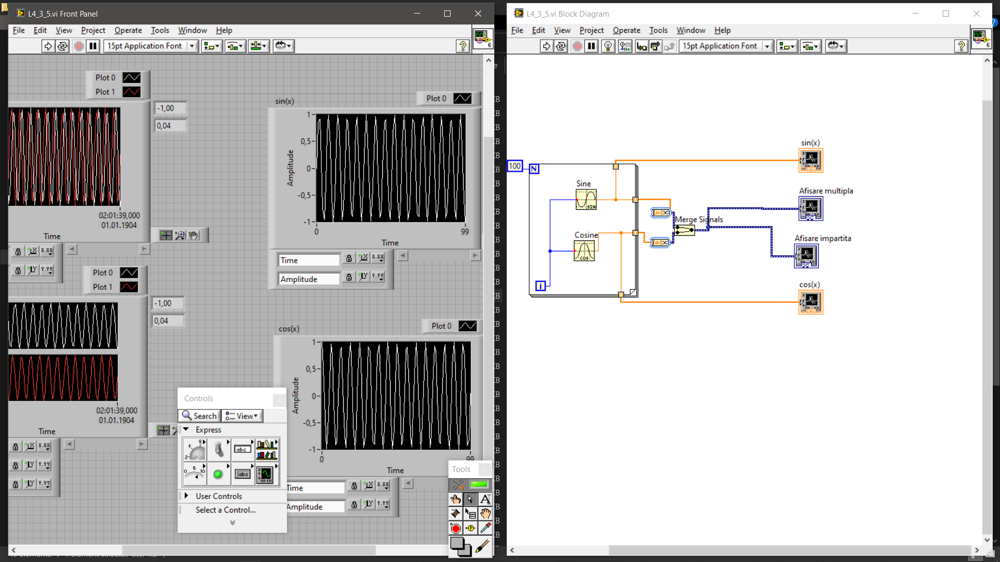

# Aplicații LabVIEW – Matrici, Vectori și Semnale

---

## 🇷🇴 Română

### Despre proiect

Acest proiect conține cinci aplicații realizate în **LabVIEW**, care demonstrează utilizarea operațiilor matematice, manipularea matricilor și vectorilor, sortarea tablourilor de date și generarea și reprezentarea grafică a funcțiilor și semnalelor.

Fiecare aplicație include interfața grafică (**Front Panel**) și diagrama bloc (**Block Diagram**), ilustrând atât rezultatul, cât și implementarea logicii de programare.

## Aplicații incluse

### 1. Operații cu matrici – `L4_3_1.vi`

**Obiectiv:** Calcularea expresiei matriciale:

$$
S=(A+B)\times C
$$

**Implementare tehnică:**
- Introducerea a trei matrici: A, B și C.
- Utilizarea funcției **Add** pentru adunarea matricilor A și B.
- Transmiterea rezultatului către funcția **Multiply**.
- Înmulțirea matricei rezultate cu matricea C.
- Afișarea matricei finale S în Front Panel.

**Concepte utilizate:** matrici, operații aritmetice, funcții Add și Multiply, conexiuni între nodurile din Block Diagram.



---

### 2. Calculul normei p a unui vector – `L4_3_2.vi`

**Obiectiv:** Calcularea normei p pentru un vector numeric.

**Implementare tehnică:**
- Introducerea unui vector de valori numerice.
- Selectarea parametrului p.
- Aplicarea funcției de valoare absolută asupra elementelor vectorului.
- Ridicarea fiecărui element la puterea p.
- Calcularea sumei valorilor obținute.
- Ridicarea sumei la puterea 1/p.
- Afișarea rezultatului final.

Formula matematică utilizată:

$$
\|x\|_p=\left(\sum_i |x_i|^p\right)^{1/p}
$$

**Concepte utilizate:** vectori, operații matematice, valoare absolută, ridicare la putere și calculul sumei elementelor.



---

### 3. Sortarea tablourilor de grupuri – `L4_3_3.vi`

**Obiectiv:** Demonstrarea sortării datelor organizate în tablouri de tip Array și Cluster.

**Implementare tehnică:**
- Utilizarea tablourilor de grupuri (Arrays of Clusters).
- Organizarea datelor în structuri care conțin informații precum nume și vârstă.
- Utilizarea funcției **Sort 1D Array** pentru sortarea datelor.
- Realizarea a două exemple de sortare: după nume și după vârstă.
- Afișarea separată a rezultatelor în Front Panel.

**Concepte utilizate:** Arrays, Clusters, Sort 1D Array și manipularea structurilor de date.



---

### 4. Reprezentarea grafică a funcției sin(x)/x – `L4_3_4.vi`

**Obiectiv:** Calcularea și reprezentarea grafică a funcției:

$$
f(x)=\frac{\sin(x)}{x}
$$

**Implementare tehnică:**
- Generarea valorilor de intrare folosind o buclă **For Loop**.
- Calcularea funcției sinus pentru fiecare valoare x.
- Împărțirea rezultatului la valoarea corespunzătoare a lui x.
- Transmiterea valorilor calculate către un indicator grafic.
- Vizualizarea variației funcției folosind **Waveform Graph**.

**Concepte utilizate:** For Loop, funcții trigonometrice, operații aritmetice și reprezentare grafică.

**Observație:** Pentru x = 0, expresia necesită tratarea separată a punctului, deoarece împărțirea directă la zero nu este definită.



---

### 5. Generarea și reprezentarea semnalelor sinus și cosinus – `L4_3_5.vi`

**Obiectiv:** Generarea și vizualizarea semnalelor sinusoidale și cosinusoidale.

**Implementare tehnică:**
- Generarea valorilor de intrare folosind o buclă **For Loop**.
- Calcularea semnalului sinusoidal sin(x).
- Calcularea semnalului cosinusoidal cos(x).
- Reunirea rezultatelor pentru reprezentarea grafică.
- Afișarea semnalelor individuale și combinate folosind indicatoare grafice.

**Concepte utilizate:** funcții trigonometrice, For Loop, generarea semnalelor și Waveform Graph.



---

## Tehnologii și concepte utilizate

- **LabVIEW** – mediu de programare grafică.
- **G Programming** – programare bazată pe diagrame bloc.
- **Arrays și Clusters** – structuri pentru organizarea și manipularea datelor.
- **For Loop** – repetarea operațiilor și generarea valorilor.
- **Add și Multiply** – operații matematice asupra matricilor.
- **Sort 1D Array** – sortarea tablourilor.
- **Waveform Graph** – reprezentarea grafică a funcțiilor și semnalelor.
- **Funcții trigonometrice** – calculul sinusului și cosinusului.

## Structura proiectului

```text
Aplicatii-LabVIEW-Matrici-Vectori-Semnale/
│
├── VI/
│   ├── L4_3_1.vi
│   ├── L4_3_2.vi
│   ├── L4_3_3.vi
│   ├── L4_3_4.vi
│   └── L4_3_5.vi
│
├── Imagini/
│   ├── L4-1.png
│   ├── L4-2.png
│   ├── L4-3.png
│   ├── L4-4.png
│   └── L4-5.png
│
└── README.md
```

## Cum se utilizează

1. Instalați o versiune compatibilă de **LabVIEW**.
2. Clonați repository-ul sau descărcați proiectul.
3. Deschideți fișierul `.vi` dorit în LabVIEW.
4. Examinați interfața Front Panel și diagrama Block Diagram.
5. Rulați aplicația folosind butonul **Run**.
6. Introduceți datele necesare și analizați rezultatele obținute.

---

# 🇬🇧 English

## About the Project

This project contains five applications developed in **LabVIEW**, demonstrating mathematical operations, matrix and vector manipulation, array sorting, and the generation and graphical representation of mathematical functions and signals.

Each application includes its graphical user interface (**Front Panel**) and its corresponding **Block Diagram**, illustrating both the output and the underlying programming logic.

## Included Applications

### 1. Matrix Operations – `L4_3_1.vi`

**Objective:** Calculate the following matrix expression:

$$
S=(A+B)\times C
$$

**Technical Implementation:**
- Input of three matrices: A, B, and C.
- Using the **Add** function to add matrices A and B.
- Passing the resulting matrix to the **Multiply** function.
- Multiplying the resulting matrix by matrix C.
- Displaying the final matrix S in the Front Panel.

**Concepts used:** matrices, arithmetic operations, Add and Multiply functions, and Block Diagram wiring.


---

### 2. Vector p-Norm Calculation – `L4_3_2.vi`

**Objective:** Calculate the p-norm of a numerical vector.

**Technical Implementation:**
- Input of a numerical vector.
- Selection of the p parameter.
- Applying the absolute value function to vector elements.
- Raising each element to the power p.
- Calculating the sum of the resulting values.
- Raising the sum to the power of 1/p.
- Displaying the final result.

Mathematical formula:

$$
\|x\|_p=\left(\sum_i |x_i|^p\right)^{1/p}
$$

**Concepts used:** vectors, mathematical operations, absolute values, exponentiation, and summation.


---

### 3. Sorting Arrays of Clusters – `L4_3_3.vi`

**Objective:** Demonstrate sorting operations on data organized in Arrays and Clusters.

**Technical Implementation:**
- Using arrays of clusters.
- Organizing data into structures containing information such as names and ages.
- Applying the **Sort 1D Array** function.
- Implementing two sorting examples: sorting by name and sorting by age.
- Displaying the sorted results separately in the Front Panel.

**Concepts used:** Arrays, Clusters, Sort 1D Array, and data structure manipulation.


---

### 4. Plotting the Function sin(x)/x – `L4_3_4.vi`

**Objective:** Calculate and graphically represent the function:

$$
f(x)=\frac{\sin(x)}{x}
$$

**Technical Implementation:**
- Generating input values using a **For Loop**.
- Calculating the sine of each input value.
- Dividing the result by the corresponding x value.
- Sending the calculated values to a graph indicator.
- Visualizing the function using a **Waveform Graph**.

**Concepts used:** For Loop, trigonometric functions, arithmetic operations, and graphical representation.

**Note:** The case x = 0 requires separate handling because direct division by zero is undefined.


---

### 5. Sine and Cosine Signal Generation and Visualization – `L4_3_5.vi`

**Objective:** Generate and visualize sine and cosine signals.

**Technical Implementation:**
- Generating input values using a **For Loop**.
- Calculating the sine signal sin(x).
- Calculating the cosine signal cos(x).
- Combining the results for graphical representation.
- Displaying individual and combined signals using graph indicators.

**Concepts used:** trigonometric functions, For Loop, signal generation, and Waveform Graph.


---

## Technologies and Concepts

- **LabVIEW** – graphical programming environment.
- **G Programming** – programming based on block diagrams.
- **Arrays and Clusters** – data organization and manipulation.
- **For Loop** – iterative operations and value generation.
- **Add and Multiply** – mathematical matrix operations.
- **Sort 1D Array** – array sorting.
- **Waveform Graph** – graphical representation of functions and signals.
- **Trigonometric Functions** – sine and cosine calculations.

## Project Structure

```text
Aplicatii-LabVIEW-Matrici-Vectori-Semnale/
│
├── VI/
│   ├── L4_3_1.vi
│   ├── L4_3_2.vi
│   ├── L4_3_3.vi
│   ├── L4_3_4.vi
│   └── L4_3_5.vi
│
├── Imagini/
│   ├── L4-1.png
│   ├── L4-2.png
│   ├── L4-3.png
│   ├── L4-4.png
│   └── L4-5.png
│
└── README.md
```

## How to Run

1. Install a compatible version of **LabVIEW**.
2. Clone the repository or download the project.
3. Open the desired `.vi` file in LabVIEW.
4. Examine the Front Panel and Block Diagram.
5. Run the application using the **Run** button.
6. Enter the required input values and analyze the results.

---

## 👤 Autor / Author

**IonutD**
